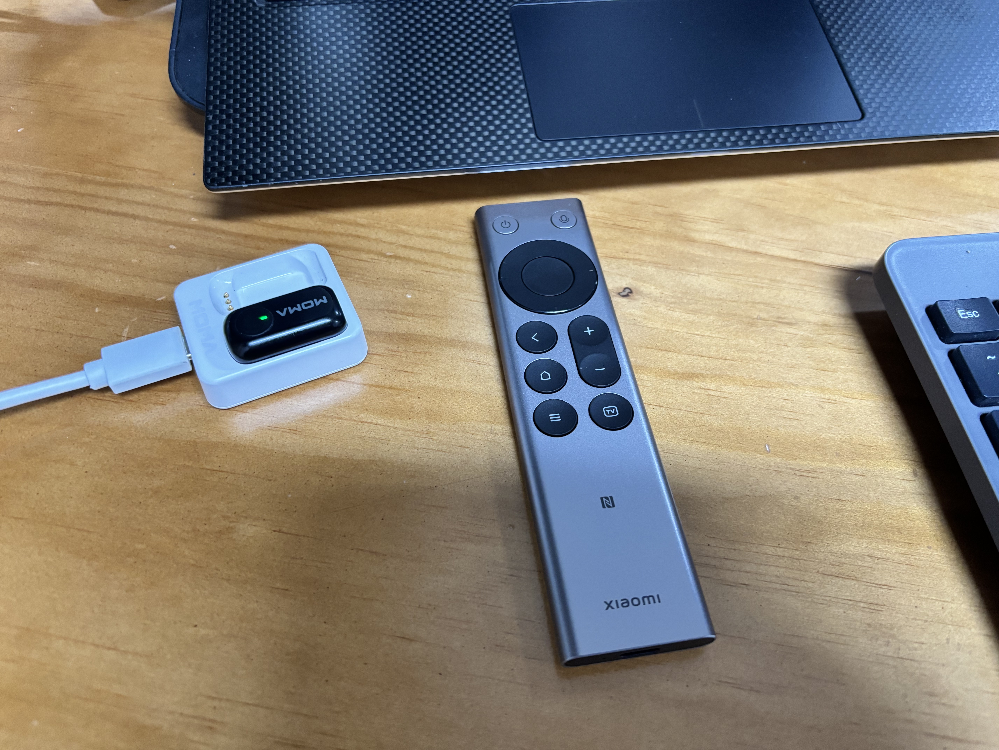
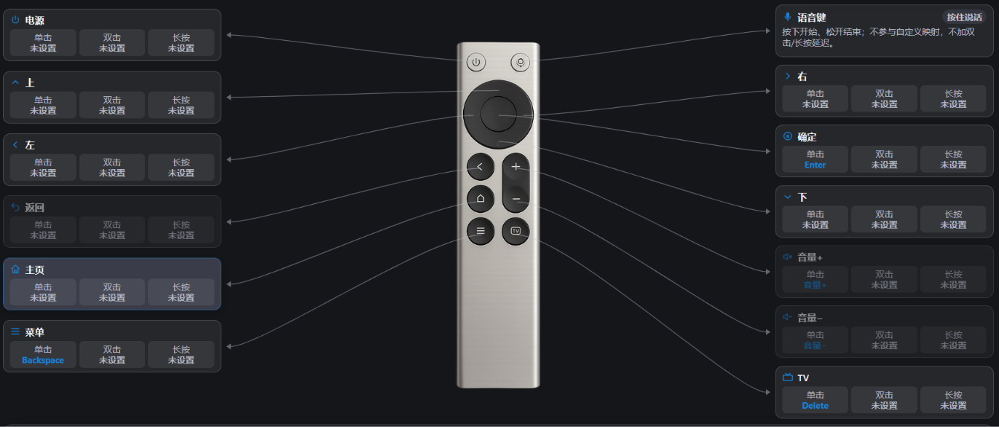

# RC003 Windows 语音键盘

把一支 99 元的小米蓝牙遥控器 2 Pro，变成 Windows 上“按住说话、松开出字”的随身语音键盘。

这不是把遥控器当普通蓝牙键盘凑合着用，而是一条已经在本机跑通的完整链路：普通按键可以当回车、退格、删除和音量键，语音键则通过虚拟声卡把声音交给微信输入法，直接写进当前输入框。

## 它解决什么

在 coding 或语音输入时，原来的流程很啰嗦：先手动打开语音输入，说完还要再手动敲一下回车，手得反复在键盘、鼠标和麦克风之间切换。

这套方案把语音输入和基础操作收进一支遥控器。按住语音键说，松开就出字；确定、返回、TV 和音量键都能映射成常用动作。手可以留在最自然的位置，不需要频繁起身、移动或切换设备。

另外，整套方案已经做成离线部署包，换电脑时不需要临时联网下载，跟着 Agent 走一遍即可。

## 工作原理

```text
小米蓝牙遥控器 2 Pro（RC003-MS）
   ├─ 普通按键 → 蓝牙 HID → SayAll 按键映射
   └─ 语音键   → 蓝牙 ATVV → SayAll 语音桥接
                                   ↓
                     CABLE Input（虚拟播放端）
                                   ↓
                        VB-CABLE 内部转发
                                   ↓
                     CABLE Output（虚拟录音端）
                                   ↓
                            微信输入法
                                   ↓
                            当前输入框
```

## 硬件与软件

| 类型 | 内容 |
| --- | --- |
| 硬件 | 小米蓝牙遥控器 2 Pro，型号 RC003-MS，Type-C 充电版 |
| 桥接 | 无线麦 SayAll Windows 1.0.0 |
| 虚拟声卡 | VB-CABLE（VB-Audio Virtual Cable） |
| 语音识别 | 微信输入法 |

## 快速开始

你不需要自己逐项配置。下载并解压 `RC003语音键盘_主机部署包_2026-10-23.zip`，里面已经带好一份 `Agent部署提示词.md`。

把这份提示词交给一个 Agent，剩下的安装、配对、配置和验收都会由 Agent 一步步带着你完成；你只需要按照指示点确认、配对和试说一句话即可。

完成后的关键配置如下：

- SayAll 语音设备：`CABLE Input`
- 微信输入法麦克风：`CABLE Output`
- 两边热键：`Ctrl + Win`
- 按键配置：导入 `SayAll-按键映射.json`
- 「Co 配置 → 锁定当前按键」：保持关闭

更详细的排障步骤见 [用户操作手册](小米蓝牙遥控器2Pro_RC003-Windows语音键盘-操作手册.md) 和 [Agent 部署手册](AGENT部署手册_小米蓝牙遥控器2Pro_RC003-Windows语音键盘.md)。

## 目录结构

```text
.
├─ README.md
├─ 小米蓝牙遥控器2Pro_RC003-Windows语音键盘-操作手册.md
├─ AGENT部署手册_小米蓝牙遥控器2Pro_RC003-Windows语音键盘.md
├─ 购买链接与项目资料.md
├─ 官方资料/
└─ RC003语音键盘_主机部署包_2026-10-23/
   ├─ 00_先看这个.md
   ├─ Agent部署提示词.md
   ├─ 01_核心文档/
   ├─ 02_按键配置/
   ├─ 03_安装程序/
   ├─ 04_官方资料/
   └─ 05_检查/
```

## 三个关键配置

`锁定当前按键` 必须关闭，否则映射空格、回车后，物理键盘的同名键会被抢占。

`全部按键支持` 默认保持关闭。它用于接管返回键、音量键等系统保留键，普通语音输入不需要。

不要把 Windows 默认播放设备设成 `CABLE Input`。只让 SayAll 使用它，系统声音就不会误入虚拟线。

## 常见问题

### 报「发现 ATVV 服务返回状态 1」

这是遥控器休眠，属于可自愈状态。按一下遥控器普通键，最多等 60 秒自动重连，不要马上删设备或重启电脑。

### 诊断显示按键一次都没收到

Windows 可能只是「已配对」而不是真正「已连接」。先关掉电视或盒子的蓝牙，再唤醒遥控器。

### 完全没声音

按顺序检查：SayAll=`CABLE Input`，微信输入法=`CABLE Output`，当前输入法是微信输入法，两边热键都是 `Ctrl + Win`，按住而不是点按。

### 觉得收音范围太远或噪声大

系统输入音量不是方向性收音范围。优先把遥控器保持在嘴部约 5–10 cm，避开风扇和空调；识别稳定即可，不要为了降噪把入口电平拉到 0。

## 已知边界

- 单次连续语音超过 60 秒的稳定性未做压力测试。
- 其他蓝牙适配器和 Windows 版本未全部验证。
- 遥控器不支持在两台电脑之间无缝一键切换；需要切换时，目前需断开当前电脑、连接另一台电脑。

## 截图





## 许可

本项目文档和自研配置采用 MIT License，见 [LICENSE](LICENSE)。第三方软件 SayAll、VB-CABLE、微信输入法和小米官方资料保留各自版权，请遵守其官方许可。

## 致谢

- [GetSayAll / remote-mic-app-windows](https://github.com/GetSayAll/remote-mic-app-windows)：SayAll Windows 版
- [VB-Audio](https://vb-audio.com/Cable)：VB-CABLE 虚拟声卡
- [微信输入法](https://z.weixin.qq.com/)：语音识别端
- [RemoteMapper-ESP32](https://github.com/cuicui-V5/RemoteMapper-ESP32)：ESP32 备选桥接方案，本项目当前未启用
